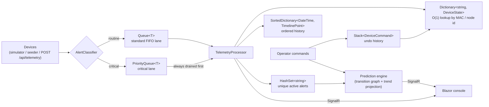

# Smart-X IoT Mesh Ecosystem — Part 2: Real-Time Processing & Device Management

A hybrid IoT gateway for the Smart-X ecosystem, built on **.NET 10**. Part 1 delivered the ingestion gateway and
sensor registration. **Part 2 turns it into a real-time processing engine**: telemetry now flows through a
two-lane queue pipeline, device state lives in dictionaries, history is kept in sorted structures, duplicate alerts
are suppressed with a set, operators can issue manual overrides with **undo**, and a prediction engine proactively
suggests what to do next.

| Project | Role |
|---|---|
| **SmartX.Api** | ASP.NET Core Minimal API: ingestion pipeline, device registry, alert tracking, commands, prediction engine, SignalR hub, device simulation |
| **SmartX.Client** | Blazor WebAssembly console: Part 1 pages plus the new Real-Time Command Stream |
| **SmartX.Shared** | Shared models and DTOs (generics, operator overloading, jagged arrays, recursion from Part 1; command, alert and suggestion models from Part 2) |
| **SmartX.DeviceSimulator** | Optional stand-alone console app that behaves like a fleet of ESP32 devices and talks to the API over HTTP |

```
SmartX.sln
├── src/SmartX.Shared           (class library — models, DTOs)
├── src/SmartX.Api              (Minimal API + SignalR + background workers)
├── src/SmartX.Client           (Blazor WebAssembly)
└── src/SmartX.DeviceSimulator  (console app — simulated devices over HTTP)
```

---

## Contents

1. [How Part 2 works](#how-part-2-works)
2. [Where each requirement lives](#where-each-requirement-lives)
3. [Prerequisites](#prerequisites)
4. [Restore, build and run](#restore-build-and-run)
5. [Running with Docker](#running-with-docker)
6. [Using the console](#using-the-console)
7. [Testing the queue, stack, dictionary and set implementations](#testing-the-queue-stack-dictionary-and-set-implementations)
8. [Testing the prediction engine](#testing-the-prediction-engine)
9. [API reference](#api-reference)
10. [Configuration reference](#configuration-reference)
11. [Part 1 features (unchanged)](#part-1-features-unchanged)
12. [Project status and repository conventions](#project-status-and-repository-conventions)

---

## How Part 2 works



1. A packet arrives (`POST /api/telemetry`, the built-in simulator, or the stand-alone device simulator).
2. `AlertClassifier` decides if it is **routine** or **critical** (a severe power spike, or a moisture reading outside its safe band).
3. Routine packets join a **`Queue<T>`** (first in, first out). Critical packets join a **`PriorityQueue<T>`** ordered by severity.
4. `TelemetryProcessor` always drains the priority queue **before** the standard queue, so a critical alert bypasses every routine packet already waiting.
5. Each processed packet updates the device **`Dictionary`**, appends to the **`SortedDictionary`** timeline, and raises (or suppresses a duplicate of) an alert in the **`HashSet`**.
6. Results are pushed to the browser over SignalR; the console never polls for live data.

---

## Where each requirement lives

| Requirement (Part 2) | Implementation | File |
|---|---|---|
| **Message queue** — FIFO for telemetry | `Queue<QueuedPacket>` (standard lane) | `src/SmartX.Api/Services/TelemetryPipeline.cs` |
| **Priority queue** — critical alerts bypass the standard queue | `PriorityQueue<QueuedPacket, (int Rank, long Sequence)>`; `TryDequeue` drains it first | `TelemetryPipeline.cs`, `TelemetryProcessor.cs`, `AlertClassifier.cs` |
| **Stack** — undo for manual overrides | `Stack<DeviceCommand>`; each command stores the actuator states from *before* it ran (works for bulk "shut down all valves") | `src/SmartX.Api/Services/CommandService.cs` |
| **Dictionary** — O(1) device lookup by MAC / node id | `Dictionary<string, DeviceEntry>` | `src/SmartX.Api/Services/DeviceStateStore.cs` |
| **Sorted dictionary** — timeline ordered by timestamp | `SortedDictionary<DateTime, TimelinePoint>` per sensor and one global log | `src/SmartX.Api/Services/TimelineStore.cs` |
| **HashSet** — unique active errors / disconnected nodes | `HashSet<string>` of `"deviceId\|kind"` keys; `Add` returning `false` = duplicate suppressed | `src/SmartX.Api/Services/AlertTracker.cs` |
| **Predictive action engine** | Weighted transition graph (first-order Markov chain with skip-gram), least-squares trend projection, heap-ranked output | `src/SmartX.Api/Services/ActionSuggestionEngine.cs` |
| **Main menu & navigation** | Pillar-grouped `NavMenu`, live alert badge, connection status, error boundary | `src/SmartX.Client/Shared/NavMenu.razor`, `MainLayout.razor` |
| **State preserved between views** | App-wide `GatewayState` (owns the one SignalR subscription, live data, form drafts and filters) | `src/SmartX.Client/Services/GatewayState.cs` |
| **Real-Time Command Stream page** | Device grid, search/filter, timeline, overrides, suggestions, live lane view | `src/SmartX.Client/Pages/CommandStream.razor` and `Shared/*.razor` |
| **Search / filter by category or alert state** | Client-side filter over the live device mirror; same filter available server-side at `GET /api/devices` | `CommandStream.razor`, `DeviceEndpoints.cs` |

---

## Prerequisites

- [.NET 10 SDK](https://dotnet.microsoft.com/download)
- Git
- (Optional) Docker Desktop, to run everything in containers

> **NuGet note:** the client uses `Microsoft.AspNetCore.Components.WebAssembly` and
> `Microsoft.AspNetCore.SignalR.Client`, and the API uses `Microsoft.AspNetCore.OpenApi` (all `10.0.0`). They are
> restored automatically by `dotnet restore`. If a version is ever reported as missing, run
> `dotnet add package <PackageName>` inside the affected project to pick up the latest compatible one.

---

## Restore, build and run

```bash
git clone <your-repo-url>
cd SmartX
dotnet restore
dotnet build
```

Run the API and the client in **two terminals** (from the repository root):

**Terminal 1 — API** (listens on `http://localhost:5000`):

```bash
dotnet run --project src/SmartX.Api
```

**Terminal 2 — Client** (serves on `http://localhost:5001` and opens your browser):

```bash
dotnet run --project src/SmartX.Client
```

The ports are fixed by each project's `Properties/launchSettings.json`. If you change the API port, also update
`src/SmartX.Client/wwwroot/appsettings.json` (`SmartX:ApiBaseUrl`).

As soon as the API starts, eight simulated ESP32 nodes begin transmitting, so the console has live data immediately.

Optional third terminal — a **stand-alone device simulator** that posts to the API over HTTP like real hardware:

```bash
dotnet run --project src/SmartX.DeviceSimulator -- --api http://localhost:5000 --devices 4
```

---

## Running with Docker

```bash
docker compose up --build
```

| Service | URL |
|---|---|
| API | http://localhost:8080 |
| Client | http://localhost:8081 |

The client container writes its `appsettings.json` at start-up from the `API_BASE_URL` environment variable
(default `http://localhost:8080`, the host-mapped API port), so no manual edit is needed. nginx is configured with an
SPA fallback, so refreshing the browser on `/command-stream` works.

Add the optional simulator container, which sends traffic to the API over the Docker network:

```bash
docker compose --profile simulator up --build
```

---

## Using the console

Open the client and use the left-hand menu. It groups the three architectural pillars:

| Pillar | Pages |
|---|---|
| Sensor Data Ingestion & Telemetry (Part 1) | Sensor Registration, Telemetry Dashboard |
| **Real-Time Command Stream (Part 2)** | **Command Stream & History** |
| Network Topology & Mesh Routing | Placeholder page — implemented in the final PoE |

Navigation never loses your place: the live feed, heartbeat streak and badges, form drafts, search text, filters,
and the selected device are all held in `GatewayState`, so you can bounce between pages freely. If the API goes down,
a banner appears and the console reconnects on its own.

### The Command Stream page

| Area | What it shows |
|---|---|
| Stats bar | Standard-queue depth, priority-queue depth, per-lane processed counts and average waits, active alerts, **duplicates suppressed**, undo-stack depth |
| 🔮 Suggested Actions / 💡 Automated Insights | What the prediction engine recommends *right now*, with confidence and the reason |
| Active Alerts | One entry per unique alert (click to focus the device) |
| Search & filter | Text search plus Category and State filters. Devices with an alert or insight are listed first |
| Device cards | Live value, status, active alerts, and **ON / OFF / Toggle** buttons on actuators |
| Sensor Timeline | SVG graph of the selected device from the sorted dictionary, anomalies in red, critical limits dashed |
| Manual Override | Send a command, **Shut down all valves**, **↩ Undo last**, plus the undo stack and command history |
| 🧪 Simulation Tools | Buttons that trigger critical alerts, queue bursts and node disconnects |
| Live Telemetry Stream | Every processed packet with its **lane** (`PRIORITY` / `standard`) and queue wait |

---

## Testing the queue, stack, dictionary and set implementations

Every test below pushes packets through **`ITelemetryPipeline.Enqueue`**, the same entry point a real device's
`POST /api/telemetry` uses. Run the API first. Commands are shown for **Bash/curl** and **Windows PowerShell**.

> JSON enums are numeric. `kind`: `0` = Float, `1` = Integer, `2` = Boolean. Command `action`: `0` = TurnOn,
> `1` = TurnOff, `2` = Toggle, `3` = ShutDownAllValves. `lane`: `0` = standard, `1` = critical (priority).

### 1. Simulate a high-priority alert

**From the UI:** Command Stream → *Simulation Tools* → **⚡ Critical power spike** (or **🏜️ Critical moisture drop**).

You should see: a red alert appear under *Active Alerts*, the device card turn red, a row marked `PRIORITY` in the
live stream, and *Suggested Actions* react.

**From the command line** (a 1050 W reading is above the 800 W critical limit):

```bash
curl -X POST http://localhost:5000/api/telemetry \
  -H "Content-Type: application/json" \
  -d '{"sensorId":"ESP32-02","kind":1,"numericValue":1050,"unit":"W"}'
```

```powershell
Invoke-RestMethod -Method Post -Uri http://localhost:5000/api/telemetry `
  -ContentType 'application/json' `
  -Body '{"sensorId":"ESP32-02","kind":1,"numericValue":1050,"unit":"W"}'
```

The response is `202 Accepted` and its `lane` is `1` with a reason starting `CRITICAL — priority lane`. A normal reading
(e.g. `300`) returns `lane: 0`.

Other quick triggers: `POST /api/simulation/critical?kind=moisture-low&deviceId=ESP32-04` (kinds: `power`,
`moisture-low`, `moisture-high`).

### 2. Prove the priority queue bypasses the standard FIFO queue

Flood the standard queue with 300 routine packets, then send **one** critical packet *behind* them:

```bash
curl -X POST "http://localhost:5000/api/simulation/burst?count=300"
curl "http://localhost:5000/api/pipeline/recent?count=100"
```

```powershell
Invoke-RestMethod -Method Post -Uri "http://localhost:5000/api/simulation/burst?count=300"
Invoke-RestMethod -Uri "http://localhost:5000/api/pipeline/recent?count=100"
```

(Or use **📦 Burst 300 + 1 critical** in the UI and watch the *Standard queue* tile climb while the stream fills.)

Because each packet takes ~20 ms to process (`ProcessingDelayMilliseconds`), the routine packets build a visible
backlog. In the `recent` output look at the entry with `"lane": 1`:

- Its `processedOrder` is **near the front** even though it was enqueued **last**.
- Its `waitMs` is a few milliseconds, while the routine packets behind it show `waitMs` in the **hundreds to thousands**.

`GET /api/pipeline/stats` confirms it with `averagePriorityWaitMs` ≪ `averageStandardWaitMs`.

**FIFO check:** among entries with `"lane": 0`, the `sequence` values increase in `processedOrder` — routine
packets are processed strictly in arrival order.

The stand-alone simulator does the same over real HTTP:

```bash
dotnet run --project src/SmartX.DeviceSimulator -- --storm 300
```

### 3. Test the undo Stack

```bash
# Turn Pump A off, then shut down every valve
curl -X POST http://localhost:5000/api/commands -H "Content-Type: application/json" -d '{"action":1,"deviceId":"ESP32-03"}'
curl -X POST http://localhost:5000/api/commands -H "Content-Type: application/json" -d '{"action":3,"deviceId":"*"}'

# The stack lists newest first (top = next to undo)
curl http://localhost:5000/api/commands

# Undo: pops the TOP command (shut down all valves) and restores both valves to ON; Pump A stays OFF
curl -X POST http://localhost:5000/api/commands/undo
curl http://localhost:5000/api/devices?category=2
```

In the UI: *Manual Override* → press **Shut down all valves**, then **↩ Undo last**. The stack panel shows the
top entry removed and both valve cards return to **ON**. Undo works through the whole stack, newest first.

### 4. Test Dictionary lookups and filtering

```bash
curl http://localhost:5000/api/devices/ESP32-03                 # O(1) lookup by node id
curl "http://localhost:5000/api/devices?query=pump"             # search by name / id / location
curl "http://localhost:5000/api/devices?category=0"             # 0 Environmental, 1 Power, 2 Actuator
curl "http://localhost:5000/api/devices?status=2"               # 0 AwaitingData, 1 Online, 2 Alert, 3 Disconnected
```

In the UI: type `pump` in *Search devices*, or pick a *Category* / *State* filter. Registering a sensor on the
**Sensor Registration** page adds it to the same dictionary, keyed by its MAC address.

### 5. Test the Sorted Dictionary timeline

```bash
curl "http://localhost:5000/api/devices/ESP32-04/timeline?take=20"   # one sensor, oldest first
curl "http://localhost:5000/api/history?take=20"                      # whole mesh, newest first
```

Timestamps are always strictly ordered with no sorting step. In the UI, click a device card and the **Sensor Timeline**
graph is drawn straight from that endpoint.

### 6. Test the HashSet (duplicate suppression and disconnects)

**Duplicate alerts.** Send the *same* critical alert twice in a row (use the button twice, or the API):

```bash
curl -X POST "http://localhost:5000/api/simulation/critical?kind=moisture-low&deviceId=ESP32-04"
curl -X POST "http://localhost:5000/api/simulation/critical?kind=moisture-low&deviceId=ESP32-04"
curl http://localhost:5000/api/pipeline/stats
curl http://localhost:5000/api/alerts
```

`activeAlertCount` is **1** (one unique entry in the set) and `duplicateAlertsSuppressed` has gone up. The alert
stays latched until the sensor reports 3 consecutive healthy readings.

**Disconnected nodes.** Silence a simulated node:

```bash
curl -X POST http://localhost:5000/api/simulation/disconnect/ESP32-05     # run again to reconnect
```

After ~15 seconds (`DisconnectTimeoutSeconds`) the node turns grey, a **Disconnected** alert appears, and
`disconnectedDeviceCount` becomes 1. The heartbeat re-checks the silent node every second, but the set accepts the alert
only **once** — the *Duplicates suppressed* tile counts the rest. Toggle it again and the node recovers and the alert clears.

---

## Testing the prediction engine

The engine learns which operator actions tend to follow which events, using a weighted transition graph, and it also
projects sensor trends. It starts with **seeded history** (simulated past operator sessions, defined in
`ActionSuggestionEngine.SeedHistory`) so it has something to say on first launch; everything you do adds to it.

**Closed-loop walkthrough** (about 45 seconds):

1. In *Manual Override*, choose **Pump A** → **Turn OFF** → **Send command**.
   Moisture Sensor B is irrigated by Pump A in the simulation, so its reading starts to drain.
2. After ~10 s, an **Automated Insight** appears: *"Moisture Sensor B is drying out — projected to drop below 20% in ~Ns"*.
   The card gets a 💡 highlight **before** anything is wrong.
3. When the reading crosses 20%, a **critical alert** fires through the priority lane.
4. *Suggested Actions* now shows **Check Pump A** and **Turn ON Pump A** with confidence scores and the reason
   (*"After Moisture Sensor B: moisture critically low, this followed about N times before"*).
5. Click **Run** on *Turn ON Pump A*. The moisture recovers, the alert clears after 3 healthy readings, and the
   command appears in the history and on the undo stack.

**Teach it something new:** search for a device (e.g. `valve 2`) while an alert is active, then run a command on it. Repeat a
few times and a new suggestion for that alert appears — the model is learning from you. Searches are reported after you
stop typing for ~1 second.

`GET /api/suggestions` returns the same data as JSON.

---

## API reference

| Method | Route | Purpose |
|---|---|---|
| `POST` | `/api/telemetry` | Ingest one reading → **202** with the lane it was queued in (`429` if the standard queue is full) |
| `GET` | `/api/telemetry/feed?count=` | Recent processed readings (with lane and queue wait) |
| `GET` | `/api/telemetry/aggregate?a=&b=` | Aggregate two meters via overloaded `+` |
| `POST` | `/api/telemetry/seed-batch` | Seed a jagged batch and flatten it |
| `GET` | `/api/pipeline/stats` | Queue depths, lane counters, average waits, duplicates suppressed |
| `GET` | `/api/pipeline/recent?count=` | Order packets were processed in, with lane and wait |
| `GET` | `/api/devices?query=&category=&status=` | Search / filter devices |
| `GET` | `/api/devices/{id}` | One device (O(1) lookup) |
| `GET` | `/api/devices/{id}/timeline?take=` | Sensor timeline, oldest first |
| `GET` | `/api/history?take=` | Mesh-wide sensor log, newest first |
| `GET` | `/api/alerts` | Active, de-duplicated alerts |
| `GET` | `/api/commands` | Command history and undo stack (top first) |
| `POST` | `/api/commands` | Issue a manual override `{ "action": 0-3, "deviceId": "ESP32-03" }` |
| `POST` | `/api/commands/undo` | Undo the most recent command |
| `GET` | `/api/suggestions` | Suggested Actions and Automated Insights |
| `POST` | `/api/activity/search` | Report an operator search `{ "query": "pump" }` |
| `POST` | `/api/simulation/critical?kind=&deviceId=` | Inject a critical reading (`power`, `moisture-low`, `moisture-high`) |
| `POST` | `/api/simulation/burst?count=` | Routine flood plus one critical packet |
| `POST` | `/api/simulation/disconnect/{id}` | Silence / un-silence a simulated node |
| `GET` / `POST` | `/api/sensors` … | Sensor registration and file upload (Part 1) |
| `GET` / `POST` | `/api/deployment/*` | Recursive deployment-tree validation (Part 1) |
| WebSocket | `/hubs/telemetry` | SignalR: `TelemetryReceived`, `DeviceChanged`, `AlertRaised`, `AlertCleared`, `PipelineStats`, `CommandsChanged`, `SuggestionsUpdated` |

In Development, the OpenAPI document is at `http://localhost:5000/openapi/v1.json`.

---

## Configuration reference

Settings live in `src/SmartX.Api/appsettings.json` under `SmartX`.

| Key | Default | Meaning |
|---|---|---|
| `MockSeeder:Enabled` | `true` | Run the built-in simulated devices |
| `MockSeeder:DeviceCount` | `8` | Number of simulated nodes (named catalogue for the first 8) |
| `MockSeeder:IntervalMilliseconds` | `2000` | Time between simulated readings |
| `MockSeeder:SpikeProbability` | `0.03` | Chance of a random spike per reading |
| `AlertRules:PowerCriticalWatts` | `800` | At or above this a power reading is critical |
| `AlertRules:MoistureCriticalLow` / `High` | `20` / `80` | Moisture outside this band is critical |
| `AlertRules:ClearAfterNormalReadings` | `3` | Healthy readings needed before an alert clears |
| `Pipeline:ProcessingDelayMilliseconds` | `20` | Simulated per-packet processing cost (makes the backlog visible) |
| `Pipeline:MaxStandardQueueDepth` | `5000` | Back-pressure limit for the standard queue |
| `Health:DisconnectTimeoutSeconds` | `15` | Silence after which a node is flagged disconnected |
| `Cors:Origins` | `[]` | Extra allowed origins (any `localhost` origin is always allowed) |

### Simulated device catalogue

| Id | Name | Category | Notes |
|---|---|---|---|
| ESP32-01 | Moisture Sensor A | Environmental | Irrigated by Valve 1 |
| ESP32-02 | Smart Meter 1 | Power | |
| ESP32-03 | Pump A | Actuator | Irrigates Moisture Sensor B |
| ESP32-04 | Moisture Sensor B | Environmental | Drains when Pump A is OFF |
| ESP32-05 | Smart Meter 2 | Power | |
| ESP32-06 | Valve 1 | Actuator | |
| ESP32-07 | Valve 2 | Actuator | |
| ESP32-08 | Smart Relay 1 | Actuator | |

---

## Part 1 features (unchanged)

| Requirement | Location |
|---|---|
| Generics — `TelemetryPacket<T>` carries float / int / bool samples without boxing | `SmartX.Shared/Models/TelemetryPacket.cs` |
| Operator overloading — `+`, `-`, comparisons on `SensorReading` | `SmartX.Shared/Models/SensorReading.cs` |
| Advanced arrays — jagged `double[][]` batch buffer, 2-D `MeshTopologyGrid` | `SmartX.Shared/Models/TelemetryBatchBuffer.cs` |
| Recursion — `DeploymentValidator` walks Facility → Zone → Sub-Zone → Device | `SmartX.Shared/Models/DeploymentNode.cs` |
| Sensor registration with file upload | `SensorRegistration.razor`, `SensorEndpoints.cs` |
| **Anomaly Heartbeat** engagement feature (pulse line + streak badges) | `TelemetryDashboard.razor` |

---

## Project status and repository conventions

- ✅ Part 1 — Sensor Data Ingestion & Telemetry
- ✅ Part 2 — Real-Time Command Stream & History
- ⬜ Final PoE — Network Topology & Mesh Routing (placeholder page in place)

Commits use conventional scopes (`feat`, `fix`, `refactor`, `chore`, `style`, `docs`) and stay small — one concern per
commit — so the history documents how each piece was built. `wwwroot/uploads/**` is git-ignored except for a
`.gitkeep`; uploaded files are runtime data, not source.
